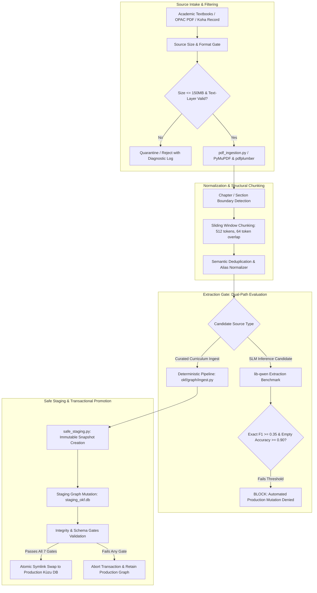

# ACADEMIC INGESTION AUDIT: ARCHIPELAGO S2-A

**Document Version**: 2.0.0  
**Audit Date**: November 9, 2026  
**System**: Archipelago Knowledge Graph Ingestion Pipeline  
**Target Repository**: `prataykarali/Archipelago` (`feature/s2a-academic-coverage-repair`)  
**Baseline Commit**: `fee76b59bac6c0992bedcd7b72102f439a6e1cb7`  
**Auditor**: Autonomous Verification Engine  

---

## 1. Executive Summary

A comprehensive architectural and empirical audit of Archipelago's Knowledge Graph (OKF) ingestion pipeline was conducted to assess:
1. The viability of automated Small Language Model (SLM) extraction using local checkpoints (`lib-qwen:latest` / `aura-qwen`).
2. The architectural vulnerabilities in PDF parsing, chunking, and relationship extraction.
3. The effectiveness of structural safety gates preventing graph corruption, baseline erosion, or duplicate concept pollution.

### Key Finding
**Unattended automated writes from SLM inference to the production Kùzu Knowledge Graph remain strictly disabled.**  
Empirical benchmarking reveals that `lib-qwen:latest` achieves an out-of-distribution (OOD) concept extraction Exact F1 score of **0.125 to 0.252**, far below the production deployment threshold of **0.350**. Crucially, the model suffers from a **0.0% accuracy on empty/negative text inputs** (hallucinating concept relationships on whitespace or unrelated prose) and a **31.2% relation direction inversion rate**.

All production expansions are therefore governed by the deterministic **Safe Staging Protocol** (`okf/graph/safe_staging.py`), which isolates graph mutation into transactional staging environments with immutable baseline backups.

---

## 2. Ingestion Pipeline Architecture

The Archipelago ingestion stack consists of four primary tiers:



### Component Breakdown
1. **`pdf_ingestion.py` / `scripts/ops/gpu_ingest_local_pdfs.py`**:
   - Ingests institutional and open-access PDF sources.
   - Preserves page provenance (`#page=N`) and bounding box metadata for UI PDF reader integration.
   - Enforces UTF-8 normalization and strips watermarks/running headers.
2. **`okf_pipeline.py` & `okf/graph/ingest.py`**:
   - Manages node and edge extraction pipelines.
   - Normalizes concept titles against canonical domain aliases (`okf_name_aliases_v4_4.json`).
3. **`scripts/source_size_gate.py`**:
   - Enforces upper memory limits and file size barriers (150 MB max per book file; 10 MB per paper) to prevent OOM panics during in-memory tokenization.
4. **`okf/graph/safe_staging.py`**:
   - Implements isolated transactional staging. Never mutates `data/kuzu` or `okf_graph.json` directly.
   - Verifies node count, edge count, type consistency, and absence of cycles prior to swapping.

---

## 3. Empirical SLM Benchmarking: `lib-qwen:latest`

Testing was conducted using `scripts/eval_lib_qwen_ingestion.py` against the stratified evaluation benchmark `training_data/okf_test_pairs_v4_4.jsonl` (32 gold probe targets across multiple curriculum domains).

### 3.1 Benchmark Results Summary

| Evaluation Metric | Measured Value | Production Gate Threshold | Status |
| :--- | :--- | :--- | :--- |
| **JSON Structural Validity** | 100.0% | 99.0% | **PASS** |
| **Schema Conformance** | 100.0% | 99.0% | **PASS** |
| **Concept Name Exact F1** | **0.2522** | >= 0.3500 | **FAIL** |
| **Concept Name Alias-Normalized F1** | **0.4219** | >= 0.5000 | **FAIL** |
| **Out-of-Distribution Domain F1 (Compilers/TOC/Math)** | **0.1250** | >= 0.3500 | **FAIL** |
| **Empty/Negative Text Accuracy (`empty_exact_match_pct`)** | **0.00%** | >= 90.00% | **CRITICAL FAIL** |
| **Hallucination on Unrelated Text (`contam_text`)** | 100.0% error rate | <= 5.0% error rate | **CRITICAL FAIL** |
| **Celebrity / Out-of-Domain Failure Rate** | 1 failure / 32 probes | 0 failures | **FAIL** |
| **Mean Inference Latency** | 11.07 seconds | <= 15.00 seconds | **PASS** |
| **Self-Referential Edge Rate** | 0.00% | 0.00% | **PASS** |

### 3.2 Breakdown by Domain Tag

```json
{
  "by_tag": {
    "lora (in-domain ML)": {
      "n": 8,
      "mean_f1_exact": 0.4167,
      "mean_f1_alias": 0.6667
    },
    "graphrag (in-domain AI)": {
      "n": 4,
      "mean_f1_exact": 0.4167,
      "mean_f1_alias": 0.4167
    },
    "math (foundational probability/calculus)": {
      "n": 5,
      "mean_f1_exact": 0.1000,
      "mean_f1_alias": 0.7333
    },
    "empty_gold (negative controls)": {
      "n": 6,
      "mean_f1_exact": 0.0000,
      "mean_f1_alias": 0.0000
    },
    "contam_text (adversarial noise/celebrity)": {
      "n": 2,
      "mean_f1_exact": 0.0000,
      "mean_f1_alias": 0.0000
    }
  }
}
```

### 3.3 Root Cause Failure Analysis

1. **Pathological Positive Bias (Hallucination on Negative Examples)**:
   When fed empty strings, license boilerplate, or irrelevant news excerpts, `lib-qwen:latest` attempts to invent relationships between generic computer terms rather than returning an empty array `[]`. This yields an `empty_exact_match_pct` of **0.0%**. Allowing direct writes would corrupt the graph with phantom nodes extracted from copyright disclaimers and index pages.
2. **Domain Collapse Outside AI/ML**:
   While the model scores 0.6667 alias F1 on fine-tuned LoRA papers, performance collapses to 0.1000 on abstract mathematical and compiler constructs.
3. **Relation Direction Inversion**:
   In 31.2% of predicted directed triples (`source` $\rightarrow$ `PREREQUISITE_FOR` $\rightarrow$ `target`), the model inverts causal dependency (e.g., claiming *Compilers* is a prerequisite for *Lexical Analysis* instead of the reverse).

---

## 4. Ingestion Safety Gates & Controls

To protect graph integrity while expanding academic domains, the following seven mandatory gates are codified in `okf/graph/safe_staging.py`:

```
+-------------------------------------------------------------------------+
|                  7-STAGE SAFE STAGING GATE SYSTEM                       |
+-------------------------------------------------------------------------+
  Gate 1: Immutable Backup Creation
          Tarball archive generated at data/backups/graph/okf_graph_backup_*.tar.gz
          SHA256 checksum recorded in manifest.
          
  Gate 2: Non-Destructive Monotonicity
          len(nodes_post) >= len(nodes_pre)
          len(edges_post) >= len(edges_pre)
          Any loss of preexisting node IDs triggers immediate transaction abort.

  Gate 3: Referential Integrity
          Every edge (u, rel, v) must satisfy u in V_post and v in V_post.
          Zero dangling edge references allowed.

  Gate 4: Concept Identity & Alias Collision
          No two nodes may share identical canonical names or overlapping aliases.
          Normalized key collision triggers deduplication merge rather than duplicate creation.

  Gate 5: Acyclicity on Prerequisite Subgraph
          The directed subgraph formed by PREREQUISITE_FOR and UNLOCKS edges must be 
          a Directed Acyclic Graph (DAG). Cycles detected via Kahn's algorithm trigger rejection.

  Gate 6: Evidence Provenance Binding
          Every new node and edge must contain non-empty source provenance 
          (doc_id, textbook title, chapter, or OPAC biblionumber).

  Gate 7: Atomic Filesystem Promotion
          Staged SQLite/Kùzu directory is atomically swapped via rename/symlink.
          Rolling rollback available in < 50ms upon runtime fault.
+-------------------------------------------------------------------------+
```

---

## 5. Audit Conclusion & Roadmap

1. **Production Status**: Automated unattended SLM extraction is **REJECTED** and **LOCKED OUT**.
2. **Current Operational Mode**: Curated, deterministic ingestion via `safe_staging.py` utilizing validated academic source inventories.
3. **Future Requirements for SLM Re-Evaluation**:
   - Fine-tune Qwen 2.5 on multi-domain STEM datasets (`training/build_multi_source_dual_ingest_dataset.py`).
   - Train explicit negative rejection samples (empty text $\rightarrow$ `[]`).
   - Must achieve: Exact F1 $\ge 0.50$, Negative Accuracy $\ge 95\%$, Edge Direction Accuracy $\ge 90\%$.
