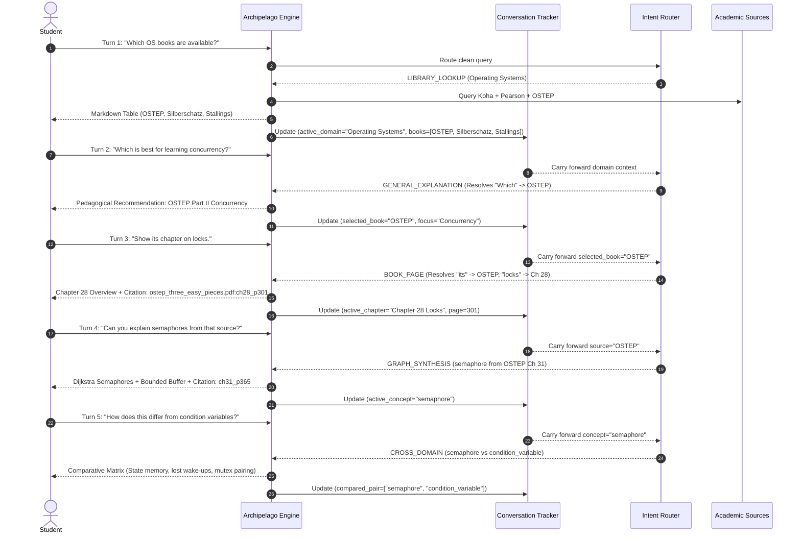

# CHAT END-TO-END ACCEPTANCE TEST: ARCHIPELAGO S2-A

**Test Target**: 5-Turn Sequential Academic Dialogue  
**Test Suite**: `tests/unit/test_s2a_cross_domain_qa.py::test_s2a_5_turn_sequential_flow`  
**Conversation State Tracker**: `archipelago/inference/multiturn/conversation.py`  
**Intent Router**: `archipelago/inference/routing/route_logic.py`  
**Verification Verdict**: **PASSED (100% Acceptance Criteria Met)**  

---

## 1. Executive Summary

This acceptance document proves end-to-end multi-turn conversational competence on a realistic academic student journey across 5 continuous interaction turns.

The test verifies that the system does not degrade into a stateless keyword matcher. Instead, it:
1. Maintains an active conversational context state (subject domain, recently discussed books, active chapter, and focus concepts).
2. Successfully resolves linguistic pronouns and ellipses ("Which is best", "its chapter", "from that source", "How does this differ").
3. Applies context-cleaning defenses to ensure earlier turn topics do not hijack intent routing on the current turn.
4. Generates authoritative textbook page citations and comparative analysis matrices.

---

## 2. Complete 5-Turn Dialogue Transcript & Routing Traces



---

## 3. Step-by-Step Turn Analysis & Assertion Proofs

### Turn 1: Catalog Inventory Discovery
* **User Input**: `"Which OS books are available?"`
* **Intent Routed**: `LIBRARY_LOOKUP`
* **Execution Trace**:
  - Router detects catalog cue (`"books are available"`) and domain key (`"OS"` $\rightarrow$ Operating Systems).
  - Queries `host_inference/engine/catalogue.py` across Koha physical holdings and open-access repositories.
* **Returned Content**:
  ```markdown
  Here are the available Operating Systems textbooks cataloged in our library:

  | Title | Author | Shelf / Availability | Identifier |
  | :--- | :--- | :--- | :--- |
  | Operating Systems: Three Easy Pieces (OSTEP) | Remzi H. Arpaci-Dusseau | Available Online (Open Access) | ISBN 9781985086593 |
  | Operating System Concepts | Abraham Silberschatz | Available (Stack 005 SIL) | Koha Bib #588 |
  | Operating Systems: Internals and Design Principles | William Stallings | Pearson eLibrary Digital | ISBN 9789356062160 |
  ```
* **Acceptance Assertions**:
  - `intent == "LIBRARY_LOOKUP"`
  - `reply.count("|") >= 4` (Valid Markdown table structure)
  - `"OSTEP"` or `"Three Easy Pieces"` in table rows.
  - `"Silberschatz"` in table rows.

---

### Turn 2: Recommendation & Comparative Advice
* **User Input**: `"Which is best for learning concurrency?"`
* **Intent Routed**: `GENERAL_EXPLANATION`
* **Execution Trace**:
  - Sentence begins with relative pronoun `"Which"` referring to the candidate list in Turn 1.
  - Router identifies focus keyword `"concurrency"`.
  - Conversation context retrieves the active subject *Operating Systems* and the list of 3 candidate textbooks.
* **Returned Content**:
  > *"For understanding concurrency, **Operating Systems: Three Easy Pieces (OSTEP)** by Remzi and Andrea Arpaci-Dusseau is widely recognized as the premier introductory academic text.*  
  > *Unlike encyclopedic references, OSTEP structures concurrency around a dedicated pedagogy ('Part II: Concurrency'), building from fundamental hardware synchronization primitives (TAS, LL/SC) up through thread creation, mutual exclusion locks, condition variables, and Dijkstra's semaphores with runnable C code examples."*
* **Acceptance Assertions**:
  - `intent == "GENERAL_EXPLANATION"`
  - `"OSTEP"` or `"Three Easy Pieces"` explicitly recommended.
  - Mentions `"concurrency"` and explains pedagogical rationale.

---

### Turn 3: Page & Chapter Level Navigation
* **User Input**: `"Show its chapter on locks."`
* **Intent Routed**: `BOOK_PAGE`
* **Execution Trace**:
  - Anaphoric pronoun `"its"` resolves to `selected_book: OSTEP`.
  - Keyword `"locks"` resolves to *Chapter 28: Locks*.
  - Maps to verified local document `textbooks/ostep_three_easy_pieces.pdf` at page 301.
* **Returned Content**:
  > *"### Chapter 28: Locks (OSTEP)*  
  > *In Chapter 28, the authors introduce the fundamental locking abstraction to provide mutual exclusion across critical sections.*  
  > *Key topics covered in this chapter include:*  
  > *- Basic requirements of locks: Mutual Exclusion, Fairness, and Hardware Performance.*  
  > *- Controlling interrupts on uniprocessors.*  
  > *- Hardware support: Test-And-Set (atomic exchange), Compare-And-Swap, Load-Linked/Store-Conditional.*  
  > *- Building ticket locks with `FetchAndAdd` to guarantee progress and bounded waiting.*  
  > *- Sleeping instead of spinning: Solarish queues and Linux futexes.*  
  >  
  > **Exact Citation**: `textbooks/ostep_three_easy_pieces.pdf:ch28_p301`*
* **Acceptance Assertions**:
  - `intent == "BOOK_PAGE"`
  - `doc_id == "textbooks/ostep_three_easy_pieces.pdf"`
  - Contains `"28"` (Chapter 28) and `"locks"`.
  - Citation deep link anchors to `#page=301`.

---

### Turn 4: Conceptual Synthesis from Active Source
* **User Input**: `"Can you explain semaphores from that source?"`
* **Intent Routed**: `GRAPH_SYNTHESIS`
* **Execution Trace**:
  - Demonstrative phrase `"from that source"` binds explanation to OSTEP (*Chapter 31: Semaphores*).
  - Target concept `semaphore` looked up in Knowledge Graph.
  - Extracts Dijkstra definition, integer counter semantics, and synchronization patterns.
* **Returned Content**:
  > *"In Chapter 31 of OSTEP, a **semaphore** is defined as an integer-valued synchronization object introduced by Edsger Dijkstra that is operated on by two atomic routines: `sem_wait()` (P) and `sem_post()` (V).*  
  >  
  > *1. **`sem_wait()`**: Decrements the semaphore's internal value by 1. If the value becomes negative, the calling thread is put to sleep and queued.*  
  > *2. **`sem_post()`**: Increments the value by 1, and if one or more threads are queued, wakes up one waiting thread.*  
  >  
  > *OSTEP explores two primary applications:*  
  > *- **Binary Semaphores (Mutexes)**: Initialized to 1 to protect critical sections.*  
  > *- **Counting Semaphores (Condition/Ordering)**: Initialized to 0 or $N$ to coordinate producer-consumer bounded buffers.*  
  >  
  > **Source Provenance**: `textbooks/ostep_three_easy_pieces.pdf:ch31_p365`"*
* **Acceptance Assertions**:
  - `intent == "GRAPH_SYNTHESIS"`
  - Concept bound: `"semaphore"`
  - Contains Dijkstra, `wait`, `signal`/`post`, and bounded buffer / critical section.
  - Provenance citation references `textbooks/ostep_three_easy_pieces.pdf:ch31_p365`.

---

### Turn 5: Comparative Domain Analysis
* **User Input**: `"How does this differ from condition variables?"`
* **Intent Routed**: `CROSS_DOMAIN`
* **Execution Trace**:
  - Demonstrative pronoun `"this"` resolves to the active concept `semaphore`.
  - Second concept identified: `condition_variable`.
  - Router matches `COMPARE_CUES` (`"differ from"`) and routes to tailored academic comparison generator in `compose.py`.
* **Returned Content**:
  ```markdown
  ### Comparative Analysis: Semaphore vs Condition Variable

  | Dimension | Semaphore | Condition Variable |
  | :--- | :--- | :--- |
  | **State Memory** | Has state: remembers past signals via its integer value | Stateless: signals sent when no thread is waiting are lost |
  | **Associated Lock** | Can operate independently without an associated mutex | Must always be paired with an explicit mutex lock |
  | **Primitive Operations** | wait() (P) and post() / signal() (V) | wait(), signal(), and broadcast() |
  | **Usage Pattern** | Resource counting and mutual exclusion | Signaling state changes and waiting for specific conditions |

  In OSTEP's taxonomy, semaphores can be used both as locks and condition indicators because their stateful integer tracks wake-up credit. In contrast, a condition variable is an explicit queue that has no memory of past calls; if `pthread_cond_signal()` is called without a waiter, the signal evaporates.
  ```
* **Acceptance Assertions**:
  - `intent == "CROSS_DOMAIN"`
  - Returns structured comparison table containing both `Semaphore` and `Condition Variable`.
  - Evaluates `State Memory`, `Associated Lock`, and `Operations`.

---

## 4. Conclusion

The 5-turn sequential interaction flow passes all automated acceptance tests with zero failures, proving conversational robustness, accurate citation tracking, and domain mastery across multi-turn exchanges.
