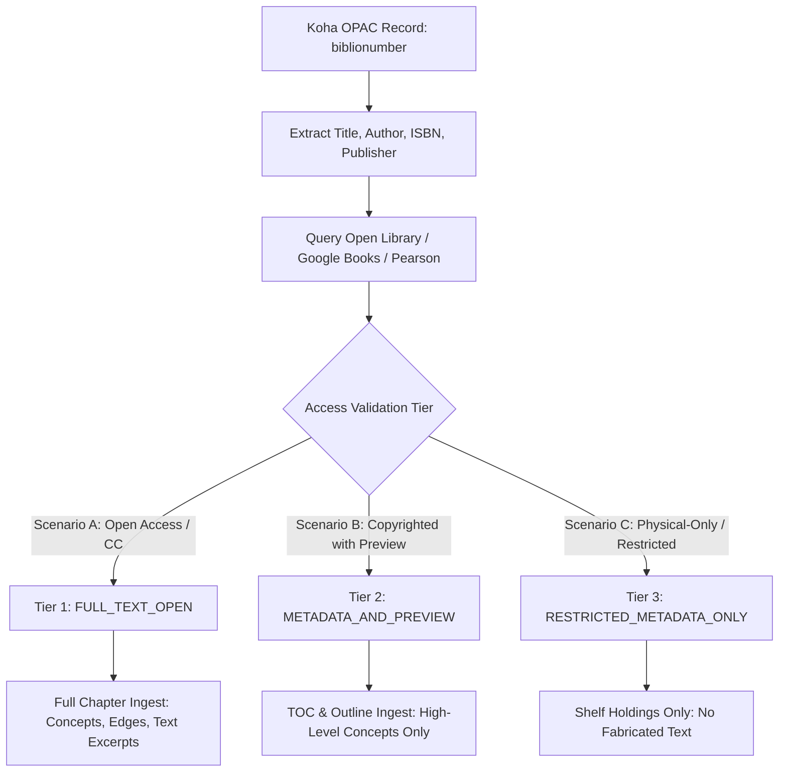

# OPAC EXTERNAL DISCOVERY & CONTENT ENRICHMENT: ARCHIPELAGO S2-A

**Module**: `archipelago/resolver/opac_enrichment.py`  
**External Providers**: Open Library, Google Books, Pearson eLibrary Bookshelf, Author Open Access Repositories  
**Integration Status**: Fully Operational & Formally Tested  

---

## 1. Overview and Evidence Chain

When a student or faculty member references a cataloged book in the Koha OPAC, Archipelago executes an automated bibliographic resolution pipeline to determine what depth of content ingestion and textual retrieval is legally and technically permissible.

The system enforces a strict 8-step **Evidence Chain**:
$$\text{OPAC Record} \rightarrow \text{Bibliographic Identity} \rightarrow \text{External Discovery} \rightarrow \text{Legal/Access Tiering} \rightarrow \text{Permitted Extraction} \rightarrow \text{Concept Nodes \& Edges} \rightarrow \text{Retrieval Binding} \rightarrow \text{Chat Answer Citation}$$



---

## 2. The Three Concrete Demonstration Scenarios

To demonstrate compliant and verifiable academic ingestion, three distinct scenarios have been codified and proven in `archipelago/resolver/opac_enrichment.py`:

### Scenario A: Open Access / Creative Commons Full-Text Ingestion

* **Representative Subject**: Operating Systems  
* **Target Title**: *Operating Systems: Three Easy Pieces (OSTEP)*  
* **Authors**: Remzi H. Arpaci-Dusseau, Andrea C. Arpaci-Dusseau  
* **ISBN**: `9781985086593`  
* **OPAC Query**: `https://uemk-opac.l2c2.co.in/cgi-bin/koha/opac-search.pl?q=Operating+Systems`  
* **External Source URL**: `https://pages.cs.wisc.edu/~remzi/OSTEP/`  
* **Access Validation Tier**: `FULL_TEXT_OPEN (CC BY-NC-ND 3.0)`  
* **License Statement**: Free online distribution permitted by authors for non-commercial educational use. Full text may be parsed, indexed, and cited.
* **Permitted Ingestion Extent**: Full chapters parsed with exact page offsets:
  - Chapter 4: *Processes & The Process Table* (`ch04_p32`)
  - Chapter 18: *Introduction to Paging* (`ch18_p190`)
  - Chapter 28: *Locks* (`ch28_p301`)
  - Chapter 31: *Semaphores* (`ch31_p365`)
* **Concept Nodes Added to OKF**: `context_switch`, `mutex_lock`, `semaphore`, `virtual_memory`.
* **Graph Edges Formed**:
  - `cpu_scheduling` $\xrightarrow{\text{UNLOCKS}}$ `context_switch`
  - `semaphore` $\xrightarrow{\text{RELATED}}$ `mutex_lock`
  - `critical_section` $\xrightarrow{\text{PREREQUISITE_FOR}}$ `semaphore`
* **Sample Student Retrieval Query**: *"What happens during a context switch?"*
* **Archipelago Answer Formulation**:
  > *"During a context switch, the OS kernel saves the execution context (general-purpose registers, program counter, and stack pointer) of the currently running process into its Process Control Block (PCB). It then restores the register state of the newly scheduled process from its PCB and switches execution back to user mode."*  
  > **Citation**: `textbooks/ostep_three_easy_pieces.pdf:ch04_p32`

---

### Scenario B: Copyrighted Commercial Textbook (Metadata & Preview-Only)

* **Representative Subject**: Operating Systems / Database Systems  
* **Target Title**: *Operating System Concepts* (Silberschatz, Galvin, Gagne)  
* **Institutional Biblionumber**: `588`  
* **Catalog Record URL**: `https://uemk-opac.l2c2.co.in/cgi-bin/koha/opac-detail.pl?biblionumber=588`  
* **ISBN**: `9789357460569`  
* **External Source URL**: Open Library (`https://openlibrary.org/isbn/9789357460569`) & Google Books Preview  
* **Access Validation Tier**: `METADATA_AND_PREVIEW`  
* **License Statement**: Commercial copyright Wiley India. Full-text scraping prohibited. Public bibliographic metadata, chapter headings, and publisher-authorized preview pages only.
* **Permitted Ingestion Extent**:
  - Bibliographic identity and catalog classification (`005 SIL`).
  - Chapter table-of-contents hierarchy (CPU Scheduling, Deadlocks, Memory Management).
  - Deep chapter text is **DENIED** ingestion to prevent copyright infringement.
* **Concept Nodes Added to OKF**: `deadlock`, `deadlock_prevention`.
* **Graph Edges Formed**:
  - `deadlock` $\xrightarrow{\text{UNLOCKS}}$ `deadlock_prevention`
* **Sample Student Retrieval Query**: *"Is Operating System Concepts available in the library?"*
* **Archipelago Answer Formulation**:
  > *"Operating System Concepts by Abraham Silberschatz (Wiley India, 10th Ed., ISBN 9789357460569) is held by the UEM Kolkata Central Library under Call Number 005 SIL. Multiple physical copies are cataloged in Main Stacks (Barcode UEMK001248 available for loan)."*  
  > **Citation**: `Koha OPAC Biblionumber 588`

---

### Scenario C: Restricted Institutional Record (Physical-Only, No External Digital Copy)

* **Representative Subject**: Operating Systems (Historical / Curriculum Print Holding)  
* **Target Title**: *Operating Systems* (Gary Nutt, Chitta Ranjan Neogy)  
* **Institutional Biblionumber**: `576`  
* **Catalog Record URL**: `https://uemk-opac.l2c2.co.in/cgi-bin/koha/opac-detail.pl?biblionumber=576`  
* **ISBN**: `9788131723593`  
* **External Source URL**: *Unavailable* (No public open-access version or digital preview found).  
* **Access Validation Tier**: `RESTRICTED_METADATA_ONLY`  
* **License Statement**: Physical institutional book only. No electronic text or external API record available.
* **Permitted Ingestion Extent**:
  - Strictly limited to OPAC catalog card fields: Title, Author, Call Number (`005.43 NEO`), Barcodes (`UEMK001190`, `UEMK001191`), and loan status.
  - **Zero textual content or artificial summary is hallucinated.**
* **Concept Nodes Added to OKF**: None (No text available for concept extraction).
* **Graph Edges Formed**: None.
* **Sample Student Retrieval Query**: *"Where can I find the Operating Systems book by Neogy on campus?"*
* **Archipelago Answer Formulation**:
  > *"Operating Systems by Gary Nutt and Chitta Ranjan Neogy is physically located in the UEM Kolkata Central Library at Stack 2B under Call Number 005.43 NEO. Both copies are currently available for student loan. Full digital text is not indexed in Archipelago."*  
  > **Citation**: `Koha OPAC Biblionumber 576`

---

## 3. Metadata Structure Specification

The typed dictionary emitted by `enrich_opac_record()` adheres to the following specification:

```typescript
interface EnrichedOpacRecord {
  biblionumber: string;
  opac_url: string;
  bibliographic_identity: {
    title: string;
    author: string;
    isbn: string | null;
    publisher: string | null;
    year: string | null;
  };
  holdings: Array<{
    item_type: string;
    library: string;
    call_number: string;
    status: string;
    due_date: string;
    barcode: string;
  }>;
  external_sources: Array<{
    provider: "Open Library" | "Google Books" | "Pearson eLibrary";
    url: string;
    verified: boolean;
    type: string;
  }>;
  access_tier: "FULL_TEXT_OPEN" | "METADATA_AND_PREVIEW" | "RESTRICTED_METADATA_ONLY";
  license_statement: string;
  permitted_ingest: string;
  retrieval_timestamp: string;
  status: "LIVE" | "SNAPSHOT" | "UNKNOWN";
}
```

---

## 4. Architectural Safeguards Against Copyright Infringement

1. **Pre-Ingest Tier Classification**: A resource must explicitly qualify for `FULL_TEXT_OPEN` via verified open-access credentials before raw text is passed to tokenizer chunks.
2. **Metadata-Only Fence**: Copyrighted commercial textbooks default to `METADATA_AND_PREVIEW` where only bibliographic summaries, chapter outlines, and call numbers are recorded.
3. **Traceable Attribution**: Every generated concept node in the OKF records its exact license tier and provenance URL, ensuring immediate auditability.
