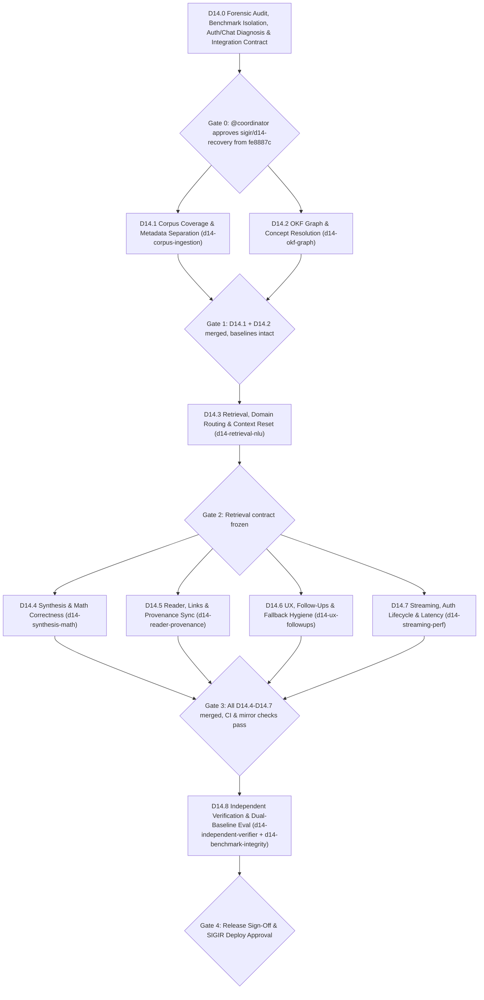

# D14 Swarm Execution Contract

- **Phase:** D14.0 — Forensic Audit & Baseline Freeze
- **Owner:** `d14-forensic-audit` (aligned with `d14-integrator` `#7` and `D14_INTEGRATION_CONTRACT.md`)
- **Date:** 2026-11-28
- **Target Release Lineage:** `sigir/d14-recovery` branched from `sigir/d12-recovery` (`fe8887c878e27f1770690236513f0f6c79c37d7c`)

---

## 1. Non-Negotiable Safety & Scientific Integrity Invariants

Every agent in the D14 swarm MUST obey these invariants without exception:

1. **UEM Institutional Production Isolation:** NEVER touch `https://archipelago-blond.vercel.app`, Vercel project `prj_yVvxBExHYiLa67oqnABK2vW9FfCS`, Supabase `spllaastejfwclllfndp`, `/home/pratay-karali/Desktop/archipelago`, or licensed Pearson e-books (`pearson_books` must remain `0` under `ARCHIPELAGO_ACCESS_PROFILE=open_access` on `archipelago-sigir`).
2. **Protected Manuscript Isolation:** NEVER modify, write to, or delete files in `/home/pratay-karali/Desktop/sigit_manu/` or `/home/pratay-karali/Desktop/sigit_manu_d11_sync_v1/`.
3. **Benchmark Quarantine:** NEVER tune on, leak, or modify the 50 held-out evaluation questions (`research/d5_sigir_evaluation/queries_heldout_50.json`), `passage_qrels.json`, or the 731-item human judgment pool, and NEVER populate blank human evaluation fields (per `docs/reports/d14/D14_BENCHMARK_ISOLATION_CONTRACT.md`).
4. **Immutable Historical Baselines:** NEVER overwrite the frozen 610-concept / 1,988-edge graph (`graph_v1_okf610`, `9818ac0e8fd30e2e...`) or the frozen 43-doc / 3,025-passage corpus manifest (`corpus_v2_d10_3025`, `93f6db39cb10d03b...`). All D14 corpus/graph improvements MUST be versioned alongside the frozen baselines (`corpus_v3_d14`, `graph_v2_d14`) so D14.8 can evaluate both independently.
5. **Engineering Standards (`AGENTS.md`):**
   - Files `<= 500` lines (prefer `<= 300`); split before hitting the limit.
   - `from __future__ import annotations` and type hints on public Python functions.
   - Zero banned patterns (`except: pass`, `except Exception: pass`, magic numbers, hardcoded credentials, `eval`, `exec`, `shell=True`, `verify=False`, unsafe `yaml.load`, prompt injection sinks).
   - `host_inference/ui/` <-> `ui/chat/` mirror sync maintained for all UI edits.
   - Every specialist slice ships with unit/regression tests and passes `ruff check`, `ruff format --check`, and `scripts/quality_gate.py` on modified files.

---

## 2. Phase Dependency DAG & Execution Order

*Fast-Track Exception (Pre-Approved by `D14_INTEGRATION_CONTRACT.md`):* Because `d14-streaming-perf`'s file slice is 100% disjoint from `D14.1`–`D14.3`, `@coordinator` may authorize an early D14.7 auth/chat-hang hotfix on `sigir/d14-recovery` immediately after Gate 0.

---

## 3. Specialist Roster, Ownership & Handoff Protocol

| Agent | Phase(s) | Owned Defect IDs | Exclusive File Ownership Summary (Canonical Map in `D14_INTEGRATION_CONTRACT.md`) | Handoff Target |
|---|---|---|---|---|
| `d14-forensic-audit` | D14.0 | Audit & Register Setup | `docs/reports/d14/D14_RELEASE_IDENTITY_AUDIT.md`, `D14_BASELINE_MANIFEST.json`, `D14_CONSOLIDATED_DEFECT_REGISTER.csv`, `D14_REQUIREMENTS_TEST_TRACEABILITY.md`, `D14_SWARM_EXECUTION_CONTRACT.md` | `@coordinator`, `@d14-integrator` |
| `d14-benchmark-integrity` | D14.0, D14.8 | Quarantine & Exposure | `docs/reports/d14/D14_BENCHMARK_EXPOSURE_AUDIT.json`, `D14_BENCHMARK_ISOLATION_CONTRACT.md` | `@coordinator`, `@d14-integrator` |
| `d14-integrator` | All | Branching, Merges, Deploys | `vercel.json`, `host_inference/ui/index.html` (+ mirror), `config.py`, `hf_revision.py`, `D14_INTEGRATION_CONTRACT.md` | `@coordinator` |
| `d14-corpus-ingestion` | D14.1 | `D14-DEF-001`..`002` | `archipelago/academic_automation/**`, `corpus_inventory.py`, `inventory_ssot.py`, `corpus_bootstrap.py`, `inventory_store.py`, `corpus_titles.py`, `inventory.py`, `ingestion_view.py`, `routes/ingest.py`, `scripts/corpus/**` | `@d14-integrator` |
| `d14-okf-graph` | D14.2 | `D14-DEF-003`..`020` | `okf/**` (excl. `okf/gold/**`), `archipelago/graph/**`, `engine/{graph,graph_semantics,nodes,pathfinder,multi_hop,multi_hop_concepts}.py`, `routes/graph.py` | `@d14-integrator` |
| `d14-retrieval-nlu` | D14.3 | `D14-DEF-021`..`028` | `engine/{intent,route_logic,routing_constants,patterns,evidence_selection,catalogue,concept_foundations,docmap,route_special_books}.py` | `@d14-integrator` |
| `d14-synthesis-math` | D14.4 | `D14-DEF-029`..`044` | `engine/{answer,compose,compose_catalog,math_guard,reply_plan,reply_evidence,reply_templates,source_answer_fixes,render}.py`, `prompts/chat_reply.txt`, `reply_templates.json` | `@d14-integrator` |
| `d14-reader-provenance` | D14.5 | `D14-DEF-045`..`052` | `engine/{citations,citation_format,links,provenance,evidence_export,access_profile}.py`, `routes/{reader,library}.py`, `page_fragments.py`, `ui/{reader.html,js/06-*,js/07-*,js/15-*}` (+ mirrors) | `@d14-integrator` |
| `d14-ux-followups` | D14.6 | `D14-DEF-053`..`062` | `engine/{followups,conversational,inventory_card}.py`, `ui/{landing.html,js/01-05*,js/11*,js/19*,js/22*,js/23*,styles/13-*,styles/14-*}` (+ mirrors) | `@d14-integrator` |
| `d14-streaming-perf` | D14.0, D14.7 | `D14-DEF-063`..`068` | `engine/{llm,diagnostics}.py`, `cache_service.py`, `remote_cache.py`, `library_index.py`, `hostapp/{factory,session_store,middleware,runtime_state,security}.py`, `routes/{auth,chat,pages}.py`, `ui/{auth_bridge.js,login.html,session-bridge.html,js/index.js,js/00-*,js/08-*,js/stream-*,js/storage-key.js}` (+ mirrors) | `@d14-integrator` |
| `d14-independent-verifier` | D14.8 | `D14-DEF-RECON` + all 68 | Read-only on production code; writes `tests/e2e/test_d14_*.py`, `docs/reports/d14/D14_VERIFICATION_REPORT.md`, `D14_EVAL_RESULTS_*.json` | `@coordinator`, owning specialist if defect found |

---

## 4. Merge, Verification & Rollback Triggers

- **Before every merge into `sigir/d14-recovery`:**
  1. Confirm zero edits outside owned slice.
  2. Run `pytest` on new D14 unit tests + existing D10/D11/D12 unit tests.
  3. Run `ruff check`, `ruff format --check`, and `python scripts/quality_gate.py` on modified files.
  4. Verify `host_inference/ui/` <-> `ui/chat/` byte-for-byte mirror parity.
- **Automatic Rollback Triggers (scoped strictly to `prj_BjRCpNfUItbG8BO26CIQbPhP1oi9` / `archipelago-sigir`):**
  - Any regression on `/api/readiness`, auth boundary (401/200), or sign-out -> sign-in lifecycle -> roll back to `fe8887c878e27f1770690236513f0f6c79c37d7c` (D12 live) or `3c724431edd11e8b987e9150b7a526675cc6501f` (`d11-a4-frozen`).
  - Any contamination of frozen 610-concept graph, 3,025-passage / 43-doc corpus, or 50 held-out questions -> immediate Gate hold until `d14-benchmark-integrity` certifies restoration.
