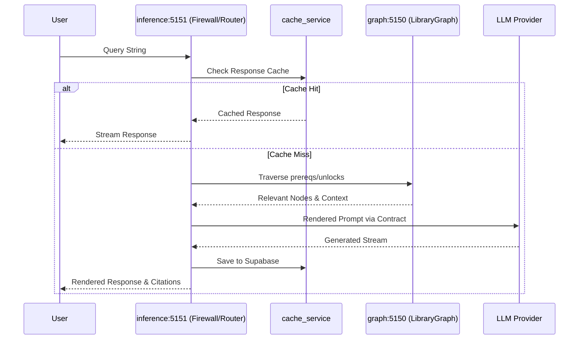
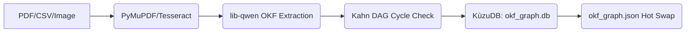
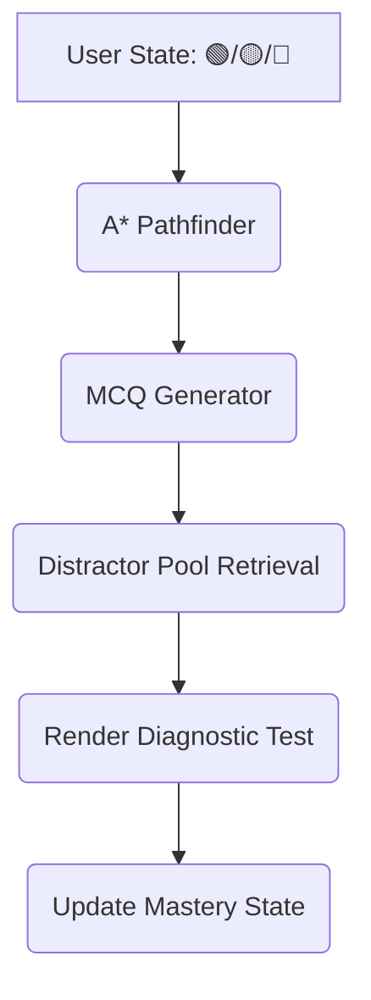

# Archipelago System Architecture

## 1. High-Level Architecture Diagram

```mermaid
graph TD
    Client[Browser / Client] --> |HTTP/SSE| ChatService
    
    subgraph AntDeploy Hosted Cluster
        ChatService[chat:5152 (Gateway)]
        InferenceEngine[inference:5151 (Logic & LLM)]
        GraphService[graph:5150 (KùzuDB Engine)]
    end
    
    ChatService <--> InferenceEngine
    InferenceEngine <--> GraphService
    
    InferenceEngine <--> Cache[(Supabase Cache)]
    InferenceEngine <--> LLM[LLM Gateway: xkiro/NIM/Gemini]
    
    subgraph Local Ingestion Appliance
        LibrarianWorker[Librarian Worker]
        PDF[PDF Parser]
        OCR[Tesseract OCR]
        Extractor[lib-qwen Extractor]
    end
    
    LibrarianWorker --> PDF
    LibrarianWorker --> OCR
    LibrarianWorker --> Extractor
    Extractor --> |OKF JSON Sync| GraphService
```

## 2. Directory Structure

> [!WARNING]
> **CRITICAL ISSUE:** Note the architectural split between `archipelago/inference/` (aspirational modular design) and `host_inference/engine/` (actual production deployment).

```text
Archipelago/
├── archipelago/           # Core Python package (Clean Architecture)
│   ├── api/               # Flask app factory + route modules
│   ├── apps/              # App entry points
│   ├── core/              # Router, retrieval, synthesis, contracts
│   ├── graph/             # KùzuDB engine wrapper
│   ├── inference/         # Massive module (~86 files) — ranking, routing, synthesis, citations, etc.
│   ├── ingestion/         # PDF, OCR, spreadsheet, Pearson, Apify, lib-qwen
│   └── ...
├── backend/               # Clean modular backend (14 sub-packages, mostly stubs/thin wrappers)
├── frontend/              # Frontend modules (mostly symlinks/stubs pointing to host_inference/ui)
├── host_inference/        # PRODUCTION inference engine (THE actual runtime)
│   ├── engine/            # Core engine: answer.py, graph.py, llm.py, contract.py, diagnostics.py
│   ├── hostapp/           # Flask app for AntDeploy (wsgi.py, routes/, middleware)
│   ├── cache_service.py   # Supabase caching
│   └── ...
├── chat_server/           # Chat gateway Flask app (:5152)
├── okf/                   # OKF extraction pipeline
├── scripts/               # Operational scripts (ingestion, sync, eval, audit)
├── training/              # Model fine-tuning scripts
├── tests/                 # Test suite
└── ...
```

## 3. Data Flow Diagrams

### Query Flow


### Ingestion Flow


### Personalized Learning Flow


## 4. Service Boundaries

| Service Component | Runtime Location | Responsibility |
| :--- | :--- | :--- |
| **host_inference/engine** | AntDeploy Cloud (`:5151`) | Execution of contracts, LLM gateway, query caching. |
| **KùzuDB / LibraryGraph** | AntDeploy Cloud (`:5150`) | In-memory K-hop traversal answering dependency queries. |
| **Ingestion Pipeline** | Local Library Appliance | Secure on-prem extraction of OKF artifacts from raw institutional docs. |
| **UI / D3.js** | Client Browser | Renders 3D library visualization and SSE chat interface. |

## 5. Duplication Analysis

> [!CAUTION]
> **Technical Debt: Parallel Implementations**
> There are TWO distinct inference implementations in the repository:
> 1. `archipelago/inference/` (~86 files, ~800KB): A deeply modular, refactored version of the system that is currently **NOT fully wired to production**.
> 2. `host_inference/engine/` (21 files, ~150KB): The actual production runtime executing on AntDeploy.
> 
> *Action Item*: `host_inference` acts as the source of truth for runtime behavior. Migrating AntDeploy configuration over to use the `archipelago/inference` package requires heavy audit and routing updates.

## 6. Technology Stack Table

| Component | Library/Tool | Version / Notes |
| :--- | :--- | :--- |
| **Web Framework** | Flask, Gunicorn | `python:3.12-slim` Docker base |
| **Graph Database** | KùzuDB | Embedded fast graph engine |
| **Auth / Cache** | Supabase | JWT role-based auth, caching endpoints |
| **PDF Extraction** | PyMuPDF (`fitz`) | Section-aware extraction |
| **OCR** | Tesseract, Pillow | `pytesseract` |
| **Embeddings** | Snowflake Arctic | Optional 1024-dim, DIM=384 hash local |
| **Lexical Search** | TheFuzz | Levenshtein distance |
| **LLM Gateway** | xkiro, NIM, Gemini, Ollama | Local fallback to `qwen3.5:0.8b` |
| **Data Parsing** | defusedxml, odfpy | Secure spreadsheet ingestion |

## 7. Known Architectural Debt

- **13 Integration Test Failures**: Blocking complete CI/CD trust.
- **Development Auth**: Authentication is actively disabled in dev environments, risking parity issues with production.
- **Incomplete Bookshelf Integration**: The Pearson bookshelf connector is incomplete.
- **Island Nodes**: OKF ingestion frequently creates disconnected "island nodes" missing `REQUIRES`/`UNLOCKS` edges.
- **Root Shim Files**: Abundance of routing shims bloating the root directory.
- **Duplicated Inference Engines**: Documented in Section 5 (see above).
- **Hardcoded Limits**: Diagnostics currently hardcodes 4 questions (`MCQ_MAX_QUESTIONS`, `CHECKPOINT_QUESTIONS`); must be parametrized/updated to 10.
- **Missing Mastery States**: Personalized learning lacks 🟠 Fading and 🔴 Missing states, time decay, and confidence calibration.
