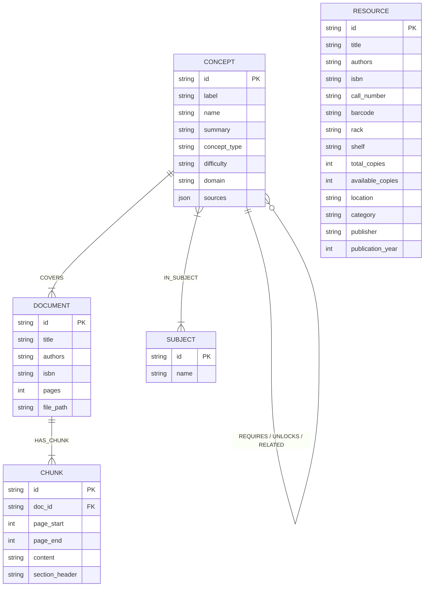

# Archipelago Data Model

This document outlines the data schemas and stores used within the Archipelago project — a curriculum-aware Hybrid Graph-Vector RAG Institutional Library Intelligence System.

## 1. KùzuDB Graph Schema

Archipelago uses KùzuDB as an embedded, highly performant graph database for storing structural relationships between concepts, documents, and library resources.

### Node Tables
*   **Concept**:
    *   `id` (STRING): Unique identifier.
    *   `label` (STRING): Primary name of the concept.
    *   `name` (STRING): Synonym or standard name.
    *   `summary` (STRING): Brief description of the concept.
    *   `concept_type` (STRING): Type (e.g., definition, theorem, algorithm, technique).
    *   `difficulty` (STRING): E.g., foundational, intermediate, advanced.
    *   `sources` (STRING/JSON): Source attribution.
    *   `domain` (STRING): Academic discipline or domain.
*   **Document**:
    *   `id` (STRING): Unique identifier.
    *   `title` (STRING): Document title.
    *   `authors` (STRING/LIST): Author(s).
    *   `isbn` (STRING): ISBN, if applicable.
    *   `pages` (INT): Total pages.
    *   `file_path` (STRING): Path to the source file.
*   **Chunk**:
    *   `id` (STRING): Chunk identifier.
    *   `doc_id` (STRING): Reference to the parent Document.
    *   `page_start` (INT): Start page.
    *   `page_end` (INT): End page.
    *   `content` (STRING): Text content.
    *   `section_header` (STRING): Section or chapter title.
*   **Resource**:
    *   `id` (STRING): Unique identifier.
    *   `title` (STRING): Resource title.
    *   `authors` (STRING): Author(s).
    *   `isbn` (STRING): ISBN.
    *   `call_number` (STRING): Library call number.
    *   `barcode` (STRING): Physical barcode.
    *   `rack` (STRING): Rack location.
    *   `shelf` (STRING): Shelf location.
    *   `total_copies` (INT): Total number of copies.
    *   `available_copies` (INT): Currently available copies.
    *   `location` (STRING): General location.
    *   `category` (STRING): Resource category.
    *   `publisher` (STRING): Publisher name.
    *   `publication_year` (INT): Year of publication.
*   **Subject**:
    *   `id` (STRING): Unique identifier.
    *   `name` (STRING): Subject name.

### Edge Tables
*   `REQUIRES` (from_concept → to_concept): Directed dependency.
*   `UNLOCKS` (from_concept → to_concept): Forward learning path.
*   `RELATED` (concept ↔ concept): Undirected or bidirectional relatedness.
*   `HAS_CHUNK` (document → chunk): Document containment.
*   `COVERS` (concept → document): Subject matter coverage.
*   `IN_SUBJECT` (concept → subject): Subject categorization.

**Schema Sources**: `archipelago/graph/engine.py`, `okf/graph/`
**Current Stats**: ~460-537 concepts, ~1,832 edges (Target: 5,151 nodes)

## 2. OKF (Open Knowledge Frame) Schema v1.6

The OKF is the extraction target schema used during document ingestion.

*   **Concept Fields**: `id`, `name/label`, `summary`, `concept_type` (definition, theorem, algorithm, technique, etc.), `difficulty` (foundational, intermediate, advanced), `domain`, `sources` (`[{doc_id, page, passage}]`).
*   **Edge Fields**: `from_id`, `to_id`, `edge_type` (`REQUIRES`/`UNLOCKS`/`RELATED`), `relation` (free text), `confidence` (float).
*   **Extraction Pipeline**: `lib-qwen extractor` → `canonicalizer` → `relation extractor` → `Kahn DAG validation`
*   **Source Files**: `okf/extraction.py`, `okf/canonicalize.py`, `okf/relations.py`, `okf/pipeline.py`, `okf/config.py`

## 3. In-Memory JSON Graph (okf_graph.json)

For hosted environments without native KùzuDB support, a pre-compiled JSON graph is used.

*   **Structure**: `{ nodes: [...], edges: [...], concepts: {...}, visualization: { nodes: [...] }, stats: {...} }`
*   **Size**: ~6.3MB JSON file.
*   **Loader**: Loaded by `LibraryGraph` in `host_inference/engine/graph.py`.
*   **Usage**: Used by hosted inference on AntDeploy (no KùzuDB access there).

## 4. Supabase Schema

Manages authentication, user profiles, and application-level caching.

*   **Tables**:
    *   `users`: `id`, `email`, `role` (`student` | `librarian` | `admin`)
    *   `profiles`: User profiles linked to users.
    *   `ai_response_cache`: Cached LLM responses.
    *   `retrieval_cache`: Vector search cache.
    *   `graph_cache`: Graph query cache.
*   **Auth**: JWT with role-based access.
*   **Location**: `supabase/migrations/`
*   **Referenced From**: `archipelago/supabase_auth/`, `archipelago/auth.py`
*   **Known Issues**: Auth is currently disabled in dev mode.

## 5. Catalog Data

*   `data/catalogs/pearson_bookshelf.json`: 40 Pearson books with `title`, `isbn`, `book_uuid`, `reader_url`, `domain`, `pages`.
*   `data/catalogs/hf_dataset_manifest.json`: HuggingFace dataset file manifest.
*   `batch*_ingestion_summary.json`: 14 batch ingestion summaries.
*   **Library Inventory CSV Schema**: `book_id`, `title`, `authors`, `publisher`, `subject`, `publication_year`, `category`, `availability`, `take_home`, `location`, `accession`, `total_copies`, `available_copies`.

## 6. File-Based Data

*   `okf_graph.db` / `okf_graph_staging.db`: KùzuDB databases (~100MB each).
*   `pdfs/`: Local directory for PDF storage.
*   `*.ods`: ODS files at root (`JOURNALS TITLES`, `SUBJECT-WISE TITLE COUNT`, `Titles List`).
*   `training_data/`: Directory for fine-tuning/training data.
*   `data/uploads/`: Directory for user uploads.

## 7. Entity Relationship Diagram

