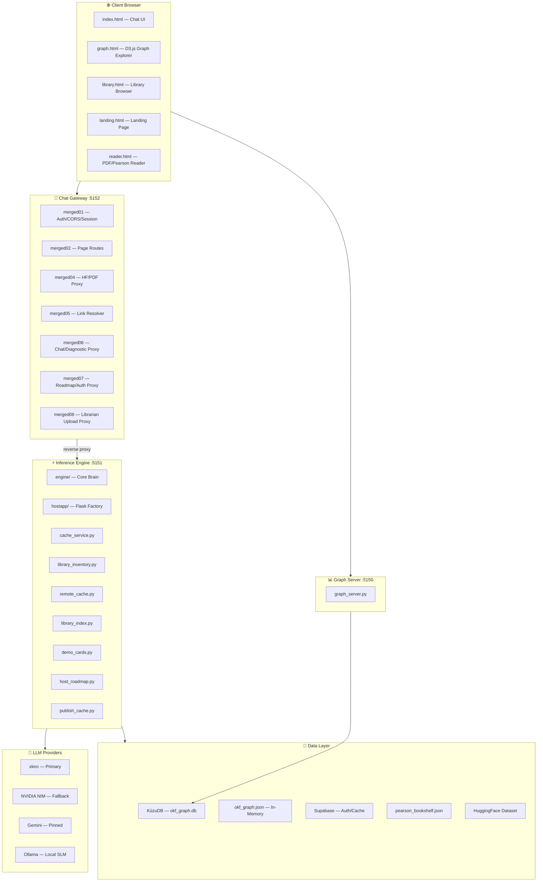
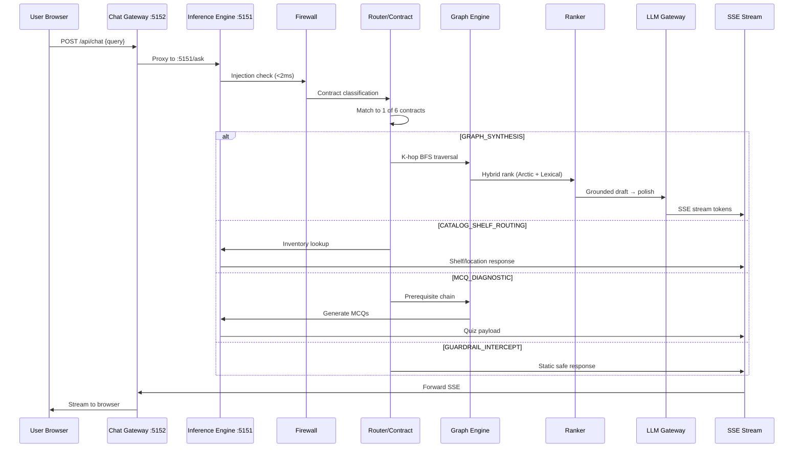

# Archipelago — Complete Codebase Mind Map

> **Purpose**: Canonical function-level reference of every module, class, and public function.
> **Rule**: This map reflects the ACTUAL codebase. Follow it. Push it.

---

## High-Level Architecture



---

## Query Pipeline Flow



---

## Module Map

### 1. `host_inference/engine/` — Production Runtime Brain (21 files)

> **This is what ACTUALLY runs on AntDeploy.** The canonical inference engine.

| File | Classes / Functions | Purpose |
|------|-------------------|---------|
| [`answer.py`](file:///home/pratay-karali/Desktop/archipelago/Archipelago/host_inference/engine/answer.py) (622L) | `Engine` — main class | **Central orchestrator**. Loads graph from `okf_graph.json`, routes queries through contracts, assembles payloads, manages streaming |
| [`contract.py`](file:///home/pratay-karali/Desktop/archipelago/Archipelago/host_inference/engine/contract.py) (163L) | `GraphDecision`, `contract_for()`, `graph_decision()` | **6 immutable contracts**: GRAPH_SYNTHESIS, CATALOG_SHELF_ROUTING, AUTH_GATEWAY, MCQ_DIAGNOSTIC, INGESTION_ANALYSIS, GUARDRAIL_INTERCEPT. `ROUTE_CONTRACT` maps 19 internal routes → contracts. `GRAPH_CONTRACTS` set determines render decision |
| [`graph.py`](file:///home/pratay-karali/Desktop/archipelago/Archipelago/host_inference/engine/graph.py) (256L) | `LibraryGraph` — `__init__`, `embed()`, `search()`, `prereqs()`, `unlocks()`, `shortest_dependency_path()`, `_walk()` | In-memory JSON graph. Builds adjacency lists (`self.out`, `self.inn`). Local 384-dim hash embeddings. K-hop BFS via `_walk()`. `PHRASE_FORCE_SCORE = 0.93` |
| [`llm.py`](file:///home/pratay-karali/Desktop/archipelago/Archipelago/host_inference/engine/llm.py) (195L) | `provider_config()`, `stream_completion()`, `maybe_polish()` | **LLM gateway**: xkiro→NVIDIA cascade. `REPLY_MAX_TOKENS=220`, `REPLY_TEMPERATURE=0.2`. `maybe_polish()` sends grounded draft for phrasing, preserves citations. On failure → returns raw draft |
| [`compose.py`](file:///home/pratay-karali/Desktop/archipelago/Archipelago/host_inference/engine/compose.py) (276L) | `domain_pair()`, `split_pair()`, `resolve_fragment()`, `synthesis()`, `relation()`, `matrix()`, `disconnected()`, `shelf()`, `shelf_generic()`, `auth_card()`, `admin_card()` | **Reply composition**: Builds grounded 3-section templates. `synthesis()` = concept explainer. `relation()` = A→B path chain. `matrix()` = comparison table. `shelf()` = catalog lookup. `auth_card()` = login prompt |
| [`diagnostics.py`](file:///home/pratay-karali/Desktop/archipelago/Archipelago/host_inference/engine/diagnostics.py) (229L) | `diagnostic_intro()`, `mcq_for()`, `diagnostic_payload()`, `_roadmap_step()`, `_personalized_roadmap()`, `adaptive_step()` | **MCQ engine**: `MCQ_MAX_QUESTIONS=4` ⚠️ MUST→10. Builds quiz from prerequisite chain. Distractor pool from 8 neighbors. Mastery states: 🟢🟡🎯 |
| [`pathfinder.py`](file:///home/pratay-karali/Desktop/archipelago/Archipelago/host_inference/engine/pathfinder.py) (130L) | `_dependency_neighbours()`, `_costs_to_target()`, `learning_path()` | **A* learning path**: Finds optimal concept traversal order. Used by diagnostics for prerequisite chain |
| [`constants.py`](file:///home/pratay-karali/Desktop/archipelago/Archipelago/host_inference/engine/constants.py) (190L) | `DIM=384`, `KILL_SWITCH=0.75`, `ALIASES` dict, `UNINDEXED_CURRICULUM_MESSAGE` | Embedding dimension, OOD thresholds, common alias mappings, guardrail messages |
| [`patterns.py`](file:///home/pratay-karali/Desktop/archipelago/Archipelago/host_inference/engine/patterns.py) | `SCHEDULE_RE`, `SHELF_RE`, `AUTH_RE`, `DIAG_RE`, `INGEST_RE`, `RELATE_RE`, `PARAM_RE` | Regex patterns for deterministic intent matching before ML routing |
| [`inventory.py`](file:///home/pratay-karali/Desktop/archipelago/Archipelago/host_inference/engine/inventory.py) (253L) | `extract_title()`, `NO_RECORD_TEMPLATE` | Physical campus inventory resolution. Parses quoted/titled/bare book refs. OPAC URL: `http://uemk-opac.l2c2.co.in` |
| [`catalogue.py`](file:///home/pratay-karali/Desktop/archipelago/Archipelago/host_inference/engine/catalogue.py) (146L) | `_candidate_roots()`, `find_catalogue_file()`, `load_catalogue()` | Loads `pearson_bookshelf.json`. Searches multiple candidate root paths |
| [`telemetry.py`](file:///home/pratay-karali/Desktop/archipelago/Archipelago/host_inference/engine/telemetry.py) (180L) | `digest_path()`, `load_digest()`, `log_demand()`, `unmet_titles()`, `render_digest()`, `clear()` | Demand analytics: tracks concept queries, unmet resource requests. JSON digest file |
| [`ingestion_view.py`](file:///home/pratay-karali/Desktop/archipelago/Archipelago/host_inference/engine/ingestion_view.py) (140L) | `jobs_index_path()`, `load_jobs()`, `latest_job()`, `_projected_nodes()`, `_projected_edges()`, `ingestion_reply()` | Renders ingestion job status as response. Projects recently-added nodes into inline graph |
| [`links.py`](file:///home/pratay-karali/Desktop/archipelago/Archipelago/host_inference/engine/links.py) | `source_links()` | Builds citation markdown with Pearson `#book/{uuid}/page/{N}` and HF `blob/main/` deep links |
| [`render.py`](file:///home/pratay-karali/Desktop/archipelago/Archipelago/host_inference/engine/render.py) | `arrow()`, `lineage()`, `neighborhood_block()` | Graph→text rendering. `lineage()` = prerequisite chain text. `neighborhood_block()` = concept context block |
| [`nodes.py`](file:///home/pratay-karali/Desktop/archipelago/Archipelago/host_inference/engine/nodes.py) | `node_public()` | Strips internal fields from concept nodes for API response |
| [`embed.py`](file:///home/pratay-karali/Desktop/archipelago/Archipelago/host_inference/engine/embed.py) | `embed()` | Local 384-dim hash-based embedding. No model download required |
| [`alias_index.py`](file:///home/pratay-karali/Desktop/archipelago/Archipelago/host_inference/engine/alias_index.py) | Alias lookup functions | Maps common abbreviations/aliases to canonical concept IDs |
| [`inventory_card.py`](file:///home/pratay-karali/Desktop/archipelago/Archipelago/host_inference/engine/inventory_card.py) | Inventory card rendering | Formats physical library holdings as response cards |

---

### 2. `host_inference/hostapp/` — Flask Factory & Routes (Production HTTP Layer)

| File | Classes / Functions | Purpose |
|------|-------------------|---------|
| [`factory.py`](file:///home/pratay-karali/Desktop/archipelago/Archipelago/host_inference/hostapp/factory.py) | `build_context()`, `create_app()` | **Flask app factory**. Builds `AppContext`, registers routes + middleware |
| [`context.py`](file:///home/pratay-karali/Desktop/archipelago/Archipelago/host_inference/hostapp/context.py) | `AppContext` | Holds engine, graph, inventory, books — injected into all route handlers |
| [`config.py`](file:///home/pratay-karali/Desktop/archipelago/Archipelago/host_inference/hostapp/config.py) | `load_env()` | Loads all 161 env vars with defaults. Called at boot |
| [`security.py`](file:///home/pratay-karali/Desktop/archipelago/Archipelago/host_inference/hostapp/security.py) | `AuthGuard`, `RateLimiter` | JWT validation, role checking, per-IP rate limiting |
| [`middleware.py`](file:///home/pratay-karali/Desktop/archipelago/Archipelago/host_inference/hostapp/middleware.py) | `_rate_limited_response()`, `register_middleware()` | CORS, rate limiting, request logging |
| [`corpus_bootstrap.py`](file:///home/pratay-karali/Desktop/archipelago/Archipelago/host_inference/hostapp/corpus_bootstrap.py) | `is_stub()`, `_hf_download()`, `_restore_fixture()`, `provision()` | Downloads corpus from HF at boot if missing. Falls back to fixture |
| [`log_redaction.py`](file:///home/pratay-karali/Desktop/archipelago/Archipelago/host_inference/hostapp/log_redaction.py) | `redact()`, `RedactingFilter`, `install_log_redaction()` | Strips API keys, tokens, passwords from all log output |
| [`inventory_store.py`](file:///home/pratay-karali/Desktop/archipelago/Archipelago/host_inference/hostapp/inventory_store.py) | `InventoryStore` | Thread-safe inventory data access |
| [`wsgi.py`](file:///home/pratay-karali/Desktop/archipelago/Archipelago/host_inference/hostapp/wsgi.py) | WSGI entrypoint | **AntDeploy production entrypoint**. `gunicorn host_inference.hostapp.wsgi:app` |

#### Routes (`hostapp/routes/`)

| File | `register()` + handlers | Endpoints |
|------|------------------------|-----------|
| [`__init__.py`](file:///home/pratay-karali/Desktop/archipelago/Archipelago/host_inference/hostapp/routes/__init__.py) | `register_routes()` | Master route registrar — calls all sub-registrars |
| [`chat.py`](file:///home/pratay-karali/Desktop/archipelago/Archipelago/host_inference/hostapp/routes/chat.py) | `_metadata_frame()`, `_withdrawn_notice()`, `register()` | `POST /ask` — main SSE chat endpoint |
| [`graph.py`](file:///home/pratay-karali/Desktop/archipelago/Archipelago/host_inference/hostapp/routes/graph.py) | `register()` | `GET /api/graph/*` — neighborhood, prereqs, unlocks, path |
| [`library.py`](file:///home/pratay-karali/Desktop/archipelago/Archipelago/host_inference/hostapp/routes/library.py) | `_dataset_domain()`, `_catalog_document_domain()`, `register()` | `GET /api/library/*` — books, catalog, inventory |
| [`reader.py`](file:///home/pratay-karali/Desktop/archipelago/Archipelago/host_inference/hostapp/routes/reader.py) | `_wants_json()`, `_find_pearson_book()`, `register()` | `GET /resolve/<id>` — Pearson/HF deep link redirect |
| [`ingest.py`](file:///home/pratay-karali/Desktop/archipelago/Archipelago/host_inference/hostapp/routes/ingest.py) | `register()` | `POST /api/ingest/*` — PDF, spreadsheet, mention, OCR upload |
| [`auth.py`](file:///home/pratay-karali/Desktop/archipelago/Archipelago/host_inference/hostapp/routes/auth.py) | `register()` | `POST /api/auth/*` — login, refresh, profile |
| [`pages.py`](file:///home/pratay-karali/Desktop/archipelago/Archipelago/host_inference/hostapp/routes/pages.py) | `register()` | Static page serving (landing, performance, safety) |
| [`static.py`](file:///home/pratay-karali/Desktop/archipelago/Archipelago/host_inference/hostapp/routes/static.py) | `register()` | Static file serving (JS, CSS, assets) |

---

### 3. `host_inference/` — Top-Level Support Modules

| File | Classes / Functions | Purpose |
|------|-------------------|---------|
| [`cache_service.py`](file:///home/pratay-karali/Desktop/archipelago/Archipelago/host_inference/cache_service.py) (369L) | `CacheMetrics`, 3-tier cache logic | Response TTL=1h, Retrieval TTL=30m, Graph TTL=2h. Supabase + local LRU fallback |
| [`library_inventory.py`](file:///home/pratay-karali/Desktop/archipelago/Archipelago/host_inference/library_inventory.py) (126L) | `parse_inventory_csv()`, `inventory_stats()`, `load_inventory()`, `save_inventory()` | CSV parsing/validation for physical library holdings |
| [`remote_cache.py`](file:///home/pratay-karali/Desktop/archipelago/Archipelago/host_inference/remote_cache.py) | `hydrate()`, `pearson_page_url()`, `public_book()`, `load_books()`, `load_library_manifest()` | Supabase storage client. Pearson URL builder. Book catalog loader |
| [`library_index.py`](file:///home/pratay-karali/Desktop/archipelago/Archipelago/host_inference/library_index.py) | `Catalog`, `load_hf_paths()`, `resolve_hf_path()`, `hf_title()`, `paper_url()`, `pearson_open()` | HuggingFace file index. URL builders for citations |
| [`demo_cards.py`](file:///home/pratay-karali/Desktop/archipelago/Archipelago/host_inference/demo_cards.py) | `match_demo()`, `_mark_withdrawn()`, `redact_for_model()` | Demo card matching. Withdrawn citation marking. Model input redaction |
| [`host_roadmap.py`](file:///home/pratay-karali/Desktop/archipelago/Archipelago/host_inference/host_roadmap.py) | `resolve_topic()`, `build_roadmap()`, `build_quiz()` | Learning roadmap builder. Quiz generation from graph topology |
| [`publish_cache.py`](file:///home/pratay-karali/Desktop/archipelago/Archipelago/host_inference/publish_cache.py) | `ensure_bucket()`, `upload_object()`, `public_catalog()`, `public_library_manifest()`, `upload_hf()`, `main()` | Publishes graph + catalog to Supabase Storage and HuggingFace |
| [`server.py`](file:///home/pratay-karali/Desktop/archipelago/Archipelago/host_inference/server.py) | `_resolve_bind_host()` | Dev server entrypoint (non-production) |

---

### 4. `chat_server/` — Chat Gateway Proxy (:5152)

> 8 merged modules. Flask app that serves UI and proxies API requests to :5151.

| File | Key Functions | Purpose |
|------|--------------|---------|
| [`merged01_repo_root.py`](file:///home/pratay-karali/Desktop/archipelago/Archipelago/chat_server/merged01_repo_root.py) | `serve_catalogs()`, `add_cors_headers()`, `_cookie_options()`, `require_verified_api_session()`, `_inference_auth_headers()`, `_is_auth_enforced()`, `_has_valid_auth_session()`, `auth_session_cookie()` | **Foundation**: CORS, auth session, cookie management |
| [`merged02_index.py`](file:///home/pratay-karali/Desktop/archipelago/Archipelago/chat_server/merged02_index.py) | `index()`, `landing()`, `chat_ui()`, `library_showcase_3d()`, `library_details()`, `reader_view()`, `performance_dashboard()`, `safety_dashboard()`, `login_page()`, `media_assets()`, `static_files()` | **Page routes**: Every HTML page served from `host_inference/ui/` |
| [`merged04_hf_token.py`](file:///home/pratay-karali/Desktop/archipelago/Archipelago/chat_server/merged04_hf_token.py) | `proxy_pdf()`, `_build_redirect_shell()` | PDF proxy with HF token injection |
| [`merged05_resolve_link_route.py`](file:///home/pratay-karali/Desktop/archipelago/Archipelago/chat_server/merged05_resolve_link_route.py) | `resolve_link_route()`, `library_data()`, `catalog_all()`, `page_view_proxy()` | **Link resolver**: `GET /resolve/<book_id>` → Pearson/HF redirect |
| [`merged06_chat_proxy.py`](file:///home/pratay-karali/Desktop/archipelago/Archipelago/chat_server/merged06_chat_proxy.py) | `chat_proxy()`, `chat_diagnostic_mcqs_proxy()`, `chat_telemetry_proxy()`, `chat_verify_mcq_proxy()`, `chat_adaptive_step_proxy()`, `dashboards_proxy()`, `readiness_proxy()` | **Chat proxy**: Forwards all chat/diagnostic/telemetry to :5151 |
| [`merged07_roadmap_proxy.py`](file:///home/pratay-karali/Desktop/archipelago/Archipelago/chat_server/merged07_roadmap_proxy.py) | `roadmap_proxy()`, `auth_proxy_or_local()`, `manage_users_api()` | Roadmap + auth + user management proxy |
| [`merged08_librarian_upload.py`](file:///home/pratay-karali/Desktop/archipelago/Archipelago/chat_server/merged08_librarian_upload.py) | `librarian_upload()`, `librarian_job_status()`, `librarian_staging_review()`, `librarian_staging_publish()`, `graph_subgraph()`, `proxy_ingest_upload()`, `proxy_ingest_status()`, `proxy_ingest_cancel()`, `proxy_documents_list()`, `proxy_document_delete()` | **Librarian tools**: Upload, staging review, publish, document management |

---

### 5. `archipelago/core/` — Clean Architecture Domain Layer

| File | Classes / Functions | Purpose |
|------|-------------------|---------|
| [`router.py`](file:///home/pratay-karali/Desktop/archipelago/Archipelago/archipelago/core/router.py) (445L) | `RoutingTier` (enum: DETERMINISTIC, HYBRID, FALLBACK), `QueryIntent` (enum: 7 intents), `QueryRouter` | **3-tier intent routing**: Tier 1 regex → Tier 2 hybrid (embed+lexical) → Tier 3 LLM. Injection detection patterns. Max 500 chars |
| [`contract.py`](file:///home/pratay-karali/Desktop/archipelago/Archipelago/archipelago/core/contract.py) | `GraphDecision`, `contract_for()`, `graph_decision()` | Mirror of engine/contract.py — same 6 contracts |
| [`retrieval.py`](file:///home/pratay-karali/Desktop/archipelago/Archipelago/archipelago/core/retrieval.py) | `_clean_query_tokens()`, `TwoPassHybridRetriever` | Two-pass retrieval: coarse graph scan → fine Arctic embed re-rank |
| [`synthesis_service.py`](file:///home/pratay-karali/Desktop/archipelago/Archipelago/archipelago/core/synthesis_service.py) | `SynthesisService` | Orchestrates retrieval → context assembly → LLM → response |
| [`prompt_assembly.py`](file:///home/pratay-karali/Desktop/archipelago/Archipelago/archipelago/core/prompt_assembly.py) | `PromptPayloadAssembler` | Builds system/user prompts with graph context, citations, constraints |
| [`citation.py`](file:///home/pratay-karali/Desktop/archipelago/Archipelago/archipelago/core/citation.py) | `SourceCitation` | Citation data class with page, URL, source type |
| [`context.py`](file:///home/pratay-karali/Desktop/archipelago/Archipelago/archipelago/core/context.py) | `RequestContext` | Per-request state carrier (session, user, query, intent) |
| [`chunk.py`](file:///home/pratay-karali/Desktop/archipelago/Archipelago/archipelago/core/chunk.py) | `RetrievedChunk`, `ContextSerializer` | Retrieved chunk data class + context serialization |
| [`manifest.py`](file:///home/pratay-karali/Desktop/archipelago/Archipelago/archipelago/core/manifest.py) | `RunManifest` | Tracks execution run metadata |

---

### 6. `archipelago/graph/` — KùzuDB Engine & Graph Operations

| File | Classes / Functions | Purpose |
|------|-------------------|---------|
| [`engine.py`](file:///home/pratay-karali/Desktop/archipelago/Archipelago/archipelago/graph/engine.py) (209L) | `KuzuGraphEngine` — `__init__`, `execute()`, `close()`, `atomic_swap()`, `_close_colocated_kuzu_handles()` | **KùzuDB wrapper**: Read-only mode, thread-safe `_swap_lock`, Cypher query execution → dict results via DataFrame. POSIX `os.replace` for atomic swap |
| [`graph_fusion.py`](file:///home/pratay-karali/Desktop/archipelago/Archipelago/archipelago/graph/graph_fusion.py) | `GraphFusionEngine` | **Kahn DAG validation** + idempotent merge. Ensures no cycles, no duplicates |
| [`traversal.py`](file:///home/pratay-karali/Desktop/archipelago/Archipelago/archipelago/graph/traversal.py) | `GraphTraversalEngine` | BFS/DFS traversal, topological sort, K-hop neighborhood |
| [`integrity.py`](file:///home/pratay-karali/Desktop/archipelago/Archipelago/archipelago/graph/integrity.py) | `GraphIntegrityReport`, `GraphIntegrityValidator` | Validates graph: dangling edges, self-loops, island nodes, baseline count |
| [`subgraph/part01_subgraphnode.py`](file:///home/pratay-karali/Desktop/archipelago/Archipelago/archipelago/graph/subgraph/part01_subgraphnode.py) | `SubgraphNode`, `SubgraphEdge`, `BoundedSubgraph`, `_get_direct_prereqs()`, `_get_direct_unlocks()`, `_get_related_neighbors()`, `_induce_subgraph_edges()` | Bounded subgraph extraction for inline chat graphs |
| [`subgraph/part02_ensure_weak_connectivity.py`](file:///home/pratay-karali/Desktop/archipelago/Archipelago/archipelago/graph/subgraph/part02_ensure_weak_connectivity.py) | `_ensure_weak_connectivity()`, `generate_bounded_subgraph()` | Ensures subgraph is weakly connected for visualization |

---

### 7. `archipelago/api/` — Flask Route Handlers

| File | Key Functions | Purpose |
|------|--------------|---------|
| [`app.py`](file:///home/pratay-karali/Desktop/archipelago/Archipelago/archipelago/api/app.py) | `_resolve_bind_host()` | Flask app factory (alternative to hostapp) |
| [`engine_state.py`](file:///home/pratay-karali/Desktop/archipelago/Archipelago/archipelago/api/engine_state.py) | `get_kuzu_connection()`, `ensure_pdf_dir()`, `load_concepts_data()`, `init_engine()`, `ensure_engine()`, `concept_node()`, `concept_name()` | Global engine state management. KùzuDB connection. Concept data loading |
| [`routes_chat.py`](file:///home/pratay-karali/Desktop/archipelago/Archipelago/archipelago/api/routes_chat.py) | `_score_query()`, `_contract_payload()`, `_handle_mcq_diagnostic()`, `_handle_direct_intents()`, `_resolve_anchor()`, `api_chat()` | **Main chat route**: Query → score → contract → handle → respond |
| [`routes_discovery.py`](file:///home/pratay-karali/Desktop/archipelago/Archipelago/archipelago/api/routes_discovery.py) | `api_topic_suggest()`, `api_roadmap_quiz()`, `api_chat_diagnostic_mcqs()`, `api_chat_verify_mcq()`, `api_chat_adaptive_step()`, `api_chat_telemetry()` | Diagnostic MCQs, roadmap quiz, adaptive learning endpoints |
| [`routes_library.py`](file:///home/pratay-karali/Desktop/archipelago/Archipelago/archipelago/api/routes_library.py) | `api_catalog_search()`, `api_eresources()`, `api_documents()` | Library catalog search (parameterized Cypher), e-resources, documents |
| [`routes_acquisition.py`](file:///home/pratay-karali/Desktop/archipelago/Archipelago/archipelago/api/routes_acquisition.py) | `librarian_demand_digest()`, `librarian_acquisition_plan()` | Librarian demand analytics and acquisition planning |
| [`routes_docs.py`](file:///home/pratay-karali/Desktop/archipelago/Archipelago/archipelago/api/routes_docs.py) | `api_readiness()`, `api_upload()` | `/api/readiness` health check + document upload |
| [`routes_auth.py`](file:///home/pratay-karali/Desktop/archipelago/Archipelago/archipelago/api/routes_auth.py) | `api_auth_config()`, `api_auth_me()`, `_current_principal()`, `api_manage_users()` | Auth config, current user, user management |
| [`contract_handlers.py`](file:///home/pratay-karali/Desktop/archipelago/Archipelago/archipelago/api/contract_handlers.py) | `_schedule_text()`, `_access_text()`, `auth_gateway_text()`, `_materials_text()`, `catalog_shelf_text()`, `ingestion_text()`, `guardrail_text()`, `direct_intent_reply()` | Contract-specific text generators for each response type |
| [`middleware.py`](file:///home/pratay-karali/Desktop/archipelago/Archipelago/archipelago/api/middleware.py) | `add_cors()`, `require_supabase_session()` | CORS headers, Supabase JWT validation |

---

### 8. `archipelago/inference/` — Ranking, Intent, Synthesis, Citations (86+ files)

> ⚠️ **MASSIVE module** — the clean-architecture split of what's also in `host_inference/engine/`. Unclear if fully wired as production runtime.

#### Core Inference

| File | Key Functions | Purpose |
|------|--------------|---------|
| [`ranking.py`](file:///home/pratay-karali/Desktop/archipelago/Archipelago/archipelago/inference/ranking.py) (500L+) | `normalize_user_query()`, `_is_identity()`, `_is_onboarding()`, `_is_chitchat()`, `_has_domain_terms()`, `_is_learning_intent()`, `_is_offtopic()`, `_expand_query_for_retrieval()`, `_score_lexical_fit()`, `rank_concepts()`, `find_anchor_concept()` | **Hybrid ranker**: Query classification → Arctic embed + lexical scoring → anchor concept resolution |
| [`intent_gate.py`](file:///home/pratay-karali/Desktop/archipelago/Archipelago/archipelago/inference/intent_gate.py) (520L+) | `_ensure_proto_embeddings()`, `_score_embed()`, `_score_lexical()`, `_llm_classify()`, `_pick()`, `_blend_scores()`, `classify_intent()`, `intent_to_block_reason()` | **Intent classifier**: 3-method blend (embed + lexical + optional LLM). Confidence thresholds: ≥0.75 execute, 0.50-0.75 suggest, <0.50 reject |
| [`synthesis.py`](file:///home/pratay-karali/Desktop/archipelago/Archipelago/archipelago/inference/synthesis.py) (200L+) | `is_ollama_available()`, `_strip_latex()`, `_scrub_slm_artifacts()`, `is_readable_synthesis()`, `enforce_sterile_prose()` | Ollama SLM integration. Output sanitization. Sterile prose enforcement |
| [`evidence_filter.py`](file:///home/pratay-karali/Desktop/archipelago/Archipelago/archipelago/inference/evidence_filter.py) | `select_target_evidence()` | Filters retrieval results to most relevant evidence chunks |
| [`rate_limit.py`](file:///home/pratay-karali/Desktop/archipelago/Archipelago/archipelago/inference/rate_limit.py) | Rate limiting logic | Per-minute (20), burst (50), global (500) rate limits |

#### Catalog Operations (`catalog_ops/`)

| File | Key Functions | Purpose |
|------|--------------|---------|
| [`part01_repo_root.py`](file:///home/pratay-karali/Desktop/archipelago/Archipelago/archipelago/inference/catalog_ops/part01_repo_root.py) | `subject_title_counts()`, `format_subject_leaderboard()`, `journal_title_and_issue_totals()`, `format_library_holdings_overview()`, `format_keyword_title_search()`, `zero_available_copies()`, `format_zero_copy_audit()` | Library catalog analytics: subject leaderboards, journal stats, keyword search, zero-copy audit |
| [`part02_format_citation.py`](file:///home/pratay-karali/Desktop/archipelago/Archipelago/archipelago/inference/catalog_ops/part02_format_citation.py) | `format_citation()`, `copies_for_title()`, `format_copies_reply()` | Citation formatting with copy availability |

---

### 9. `archipelago/ingestion/` — Document Ingestion Pipeline

| File | Key Functions / Classes | Purpose |
|------|------------------------|---------|
| [`pdf_io.py`](file:///home/pratay-karali/Desktop/archipelago/Archipelago/archipelago/ingestion/pdf_io.py) | `ingest_document()`, `ingest_folder()` | **PDF ingestion**: PyMuPDF section-aware chunking |
| [`pdf_formats.py`](file:///home/pratay-karali/Desktop/archipelago/Archipelago/archipelago/ingestion/pdf_formats.py) | `chunk_markdown()`, `chunk_text()`, `chunk_docx()` | Multi-format document chunking (MD, TXT, DOCX) |
| [`fetch_policy.py`](file:///home/pratay-karali/Desktop/archipelago/Archipelago/archipelago/ingestion/fetch_policy.py) (380L) | `FetchDecision`, `RobotsRules`, `allowlist()`, `host_permitted()`, `audit()`, `parse_robots()`, `robots_for()`, `carries_credentials()`, `check_fetch()`, `guarded_fetch()` | **DENY-ALL fetch policy**: Allowlist, robots.txt, audit trail, credential detection |
| [`apify_source.py`](file:///home/pratay-karali/Desktop/archipelago/Archipelago/archipelago/ingestion/apify_source.py) (270L) | `ApifyNotConfigured`, `ApifyBudgetError`, `FetchRefused`, `configured()`, `resolve_charge_cap()`, `search_actors()`, `gate_start_urls()`, `run_actor()`, `fetch_dataset_items()` | **Apify integration**: Actor search, budget-capped execution ($1.00 hard cap), dataset retrieval |
| [`pearson_connector.py`](file:///home/pratay-karali/Desktop/archipelago/Archipelago/archipelago/ingestion/pearson_connector.py) | Pearson portal connection | Institutional subscription extraction (⚠️ cold redirect fails) |

#### Ingestion Sub-Modules

| Directory | Purpose |
|-----------|---------|
| `spreadsheet/` — `part01_logger.py`, `part02_apply_merge.py` | ODS/CSV/XLSX ingestion with `RecordChange`, `MergePlan`, Cypher merge statements |
| `page_image/` | Scanned page OCR via Tesseract |
| `mention/` | Mention-a-Book auto-populate |
| `lib_qwen_extractor/` | lib-qwen model extraction wrapper |
| `librarian_worker/` | Background ingestion worker |
| `pdf_chunk/` | Section-aware PDF chunking (⚠️ needs TOC/bibliography filter) |

---

### 10. `okf/` — Open Knowledge Frame Extraction Pipeline

| File | Key Functions | Purpose |
|------|--------------|---------|
| [`extraction.py`](file:///home/pratay-karali/Desktop/archipelago/Archipelago/okf/extraction.py) (360L) | `is_local_mode()`, `is_model_loaded()`, `normalize_okf_item()`, `load_local_model()`, `_generate_local()`, `extract_okf_v15()`, `extract_chunks_with_model()` | **OKF v1.5/1.6 extraction**: Local lib-qwen model → structured concept/relation JSON. GBNF grammar constraints |
| [`canonicalize.py`](file:///home/pratay-karali/Desktop/archipelago/Archipelago/okf/canonicalize.py) | `is_same_concept_reference()`, `canonicalize_name()`, `build_canonical_map()`, `apply_canonicalization()` | **Concept deduplication**: Fuzzy name matching, canonical form mapping |
| [`relations.py`](file:///home/pratay-karali/Desktop/archipelago/Archipelago/okf/relations.py) (370L) | `extract_relations_for_record()`, `relation_pass()`, `validate_relation()`, `filter_relations()`, `infer_prerequisite_direction()`, `build_validated_edges()` | **Relation extraction**: Passage-based candidate mining, direction inference, validation |
| [`config.py`](file:///home/pratay-karali/Desktop/archipelago/Archipelago/okf/config.py) | `resolve_local_model_path()`, `infer_source_category()` | Model path resolution, source categorization |
| [`graph_db.py`](file:///home/pratay-karali/Desktop/archipelago/Archipelago/okf/graph_db.py) | Module-level proxied state | KùzuDB connection state management |
| [`pipeline/part01_filter_extracted_relations.py`](file:///home/pratay-karali/Desktop/archipelago/Archipelago/okf/pipeline/part01_filter_extracted_relations.py) | `filter_extracted_relations()`, `finalize_and_build()`, `run_pipeline()`, `compute_doc_id()` | **Master pipeline**: PDF → chunks → extraction → filtering → graph build |
| [`pipeline/part02_add_document.py`](file:///home/pratay-karali/Desktop/archipelago/Archipelago/okf/pipeline/part02_add_document.py) | `add_document()` | Single document ingestion into graph |

---

### 11. `scripts/` — Operational Tooling

| File | Key Functions | Purpose |
|------|--------------|---------|
| [`quality_gate.py`](file:///home/pratay-karali/Desktop/archipelago/Archipelago/scripts/quality_gate.py) (300L) | `BannedPattern`, `GateResult`, `find_python_files()`, `main()` | CI quality gate: banned patterns, magic numbers, file length |
| [`qa_three_bugs_harness.py`](file:///home/pratay-karali/Desktop/archipelago/Archipelago/scripts/qa_three_bugs_harness.py) (360L) | `check_truncation_budget()`, `check_link_thresholds()`, `check_paper_card_contract()`, `check_company_eval_sample()`, `run_harness()` | QA harness: truncation, link validation, paper card, eval checks |
| [`download_pilot_corpus.py`](file:///home/pratay-karali/Desktop/archipelago/Archipelago/scripts/download_pilot_corpus.py) (780L) | `download_papers()`, `prepare_books()`, `build_manifest()`, `upload_to_huggingface()`, `main()` | Full pilot corpus download + HF upload orchestrator |
| [`run_master_library_ingest.py`](file:///home/pratay-karali/Desktop/archipelago/Archipelago/scripts/run_master_library_ingest.py) (750L) | `run_batch_ingest()`, `_subgraph_hammer()`, `main()` | **Master ingestion orchestrator**: Multi-batch GPU ingestion |
| [`sync_to_hf_library.py`](file:///home/pratay-karali/Desktop/archipelago/Archipelago/scripts/sync_to_hf_library.py) | `sync_all()` | Sync graph + catalog → HuggingFace `Prataykarali/Library_books` |
| [`run_sync_service.py`](file:///home/pratay-karali/Desktop/archipelago/Archipelago/scripts/run_sync_service.py) | `graph_stats()`, `push_once()`, `main()` | Graph sync service for pushing updates to remote |
| [`build_corpus_fixture.py`](file:///home/pratay-karali/Desktop/archipelago/Archipelago/scripts/build_corpus_fixture.py) | `pick()`, `build()`, `main()` | Builds minimal fixture corpus for testing |
| [`kaggle_ingest.py`](file:///home/pratay-karali/Desktop/archipelago/Archipelago/scripts/kaggle_ingest.py) | `push_kaggle_notebook()`, `wait_for_kernel()`, `wait_for_graph_on_hf()`, `main()` | Kaggle GPU ingestion pipeline |
| [`validate_graph.py`](file:///home/pratay-karali/Desktop/archipelago/Archipelago/scripts/validate_graph.py) | Graph validation | Validates graph integrity post-ingestion |

---

### 12. `backend/` — Thin Wrapper Layer (14 sub-packages)

> Mostly stubs/thin wrappers importing from `archipelago/` internals.

| Sub-Package | Content | Status |
|-------------|---------|--------|
| `routing/` | Intent routing wrapper | Thin |
| `intent/` | `is_greeting()` | Minimal |
| `retrieval/` | Retrieval wrapper | Thin |
| `graph/` | Graph wrapper | Thin |
| `synthesis/` | Synthesis wrapper | Thin |
| `citations/` | Citation wrapper | Thin |
| `personalization/` | Personalization wrapper | Stub |
| `catalog/` | Catalog wrapper | Thin |
| `authentication/` | Auth wrapper | Thin |
| `ingestion/` | Ingestion wrapper | Thin |
| `OCR/` | `perform_ocr()` | Functional |
| `quiz/` | Quiz wrapper | Thin |
| `caching/` | Caching wrapper | Thin |
| `telemetry/` | `TelemetryTracker` | Functional |

---

### 13. `frontend/` — UI Assets (mostly stubs → real UI in `host_inference/ui/`)

| Directory | Content | Status |
|-----------|---------|--------|
| `chat/` | `ui` file (13 bytes — symlink) | ⚠️ STUB |
| `graph/` | `ui` file (14 bytes — symlink) | ⚠️ STUB |
| `library/` | Unknown | ⚠️ STUB |
| `landing/` | EMPTY | ⚠️ EMPTY |
| `quiz/` | EMPTY | ⚠️ EMPTY |
| `book-stack/` | `books_showcase_src.tsx` (28 bytes) | ⚠️ STUB (real 68KB TSX at repo root) |
| `citations/` | Unknown | ⚠️ STUB |
| `shared/` | Unknown | ⚠️ STUB |

**Real UI lives in:**
- [`host_inference/ui/`](file:///home/pratay-karali/Desktop/archipelago/Archipelago/host_inference/ui/) — HTML pages, JS modules, styles
- [`host_inference/ui_assets/`](file:///home/pratay-karali/Desktop/archipelago/Archipelago/host_inference/ui_assets/) — Videos, icons, images (22 files)

---

## Module Dependency Graph

```mermaid
graph TD
    subgraph PRODUCTION["🔴 Production Path (AntDeploy)"]
        WSGI["wsgi.py"] --> FACTORY["hostapp/factory.py"]
        FACTORY --> CTX["hostapp/context.py"]
        FACTORY --> ROUTES["hostapp/routes/"]
        FACTORY --> MW["hostapp/middleware.py"]
        FACTORY --> SEC["hostapp/security.py"]
        FACTORY --> BOOT["hostapp/corpus_bootstrap.py"]
        ROUTES --> ENGINE["engine/answer.py"]
        ENGINE --> CONTRACT["engine/contract.py"]
        ENGINE --> GRAPH["engine/graph.py"]
        ENGINE --> LLMGW["engine/llm.py"]
        ENGINE --> COMPOSE["engine/compose.py"]
        ENGINE --> DIAG["engine/diagnostics.py"]
        ENGINE --> PATH["engine/pathfinder.py"]
        ENGINE --> INV["engine/inventory.py"]
        ENGINE --> TELEM["engine/telemetry.py"]
        COMPOSE --> GRAPH
        DIAG --> GRAPH
        DIAG --> PATH
        LLMGW -->|"xkiro→NVIDIA"| EXTERNAL_LLM["External LLMs"]
    end

    subgraph GATEWAY["🟡 Chat Gateway (:5152)"]
        CHAT_SVR["chat_server/merged01-08"] -->|"proxy"| ROUTES
    end

    subgraph CLEAN["🟢 Clean Architecture (not primary runtime)"]
        APP["archipelago/api/app.py"]
        APP --> CORE_RT["core/router.py"]
        APP --> CORE_RET["core/retrieval.py"]
        APP --> CORE_SYN["core/synthesis_service.py"]
        APP --> INF_RK["inference/ranking.py"]
        APP --> INF_IG["inference/intent_gate.py"]
        APP --> GRAPH_ENG["graph/engine.py"]
        GRAPH_ENG --> KUZU_DB["KùzuDB"]
    end

    subgraph INGESTION["🔵 Ingestion Pipeline"]
        OKF_PIPE["okf/pipeline/"] --> OKF_EXT["okf/extraction.py"]
        OKF_PIPE --> OKF_CAN["okf/canonicalize.py"]
        OKF_PIPE --> OKF_REL["okf/relations.py"]
        OKF_PIPE --> GRAPH_FUSE["graph/graph_fusion.py"]
        PDF_IO["ingestion/pdf_io.py"] --> OKF_PIPE
        FETCH["ingestion/fetch_policy.py"] --> APIFY["ingestion/apify_source.py"]
        SPREAD["ingestion/spreadsheet/"] --> GRAPH_ENG
    end

    ENGINE -.->|"loads"| JSON_GRAPH["okf_graph.json"]
    GRAPH_ENG -.->|"queries"| KUZU_DB
    BOOT -.->|"downloads"| HF_DS["HuggingFace Dataset"]
```



---

## Configuration & Deployment Files

| File | Purpose |
|------|---------|
| [`.env.example`](file:///home/pratay-karali/Desktop/archipelago/Archipelago/.env.example) (161L) | All 161 environment variables with defaults |
| [`.antideploy.json`](file:///home/pratay-karali/Desktop/archipelago/Archipelago/.antideploy.json) (22L) | AntDeploy deployment config. ⚠️ `ARCHIPELAGO_AUTH_REQUIRED=0` |
| [`docker-compose.yml`](file:///home/pratay-karali/Desktop/archipelago/Archipelago/docker-compose.yml) (79L) | 3 services: inference:5151, graph:5150, chat:5152 |
| [`Dockerfile`](file:///home/pratay-karali/Desktop/archipelago/Archipelago/Dockerfile) (33L) | python:3.12-slim + tesseract-ocr |
| [`requirements.txt`](file:///home/pratay-karali/Desktop/archipelago/Archipelago/requirements.txt) (30L) | All Python dependencies |
| [`pyproject.toml`](file:///home/pratay-karali/Desktop/archipelago/Archipelago/pyproject.toml) (121L) | Ruff, Mypy strict, Bandit, pytest, coverage config |
| [`start.sh`](file:///home/pratay-karali/Desktop/archipelago/Archipelago/start.sh) (42L) | Boot script for dev/docker |
| [`app.py`](file:///home/pratay-karali/Desktop/archipelago/Archipelago/app.py) (22L) | Thin entrypoint importing `archipelago.api.app` |

---

## ⚠️ Critical Architectural Note

```
┌─────────────────────────────────────────────────────────────┐
│  TWO PARALLEL CODEBASES — MUST RESOLVE (ADR-005)            │
│                                                             │
│  host_inference/engine/  ← PRODUCTION (AntDeploy runs this) │
│    21 files, ~150KB                                         │
│    answer.py, graph.py, llm.py, contract.py, diagnostics.py │
│                                                             │
│  archipelago/inference/  ← CLEAN ARCHITECTURE SPLIT         │
│    86+ files, ~800KB                                        │
│    ranking.py, intent_gate.py, synthesis.py, catalog_ops/   │
│                                                             │
│  Both implement routing, graph, synthesis independently.    │
│  Canonical runtime decision REQUIRED before further work.   │
└─────────────────────────────────────────────────────────────┘
```
